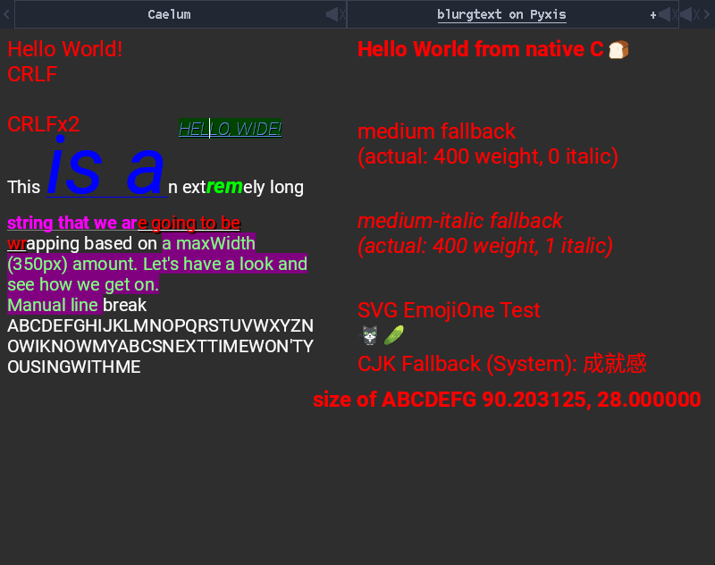

# blurgtext upstream demo, 2026-10-24

QEMU qualification of the first native port: real FreeType/HarfBuzz, the
unchanged upstream demo and package-backed system-font discovery. No native
hardware, performance, hostile-font or general thread-safety claim.

## Revisions and build

The tested code/image revision is Pyxis `688bdd473e1f`, containing the fonts
integration `dd0b74d88196`. The ports pin is `3568a53` (blurgtext), containing
`fc302ab` (font additions). Later changes in this PR add only this record, its
links and the actual capture. Userland, fs and lwIP stayed at the parent pins;
no code or dependency pin outside ports changed.

The library is pinned to CallumDev/blurgtext
`e11c19f4bc124ea8bb1cc7a30e82737a676198f0`, with all direct/nested submodules and
release archives in [metadata](../../../../ports/blurgtext/metadata.lua).
The ordinary published `pyxis-llvm23.1.3-3d69e83` compiler container built a fresh
SDK, current kernel/userland, Mesa 26.2.5 softpipe and SDL2 2.32.10. The focused
ports recipe fetched only verified cached archives, applied all four patches,
and built/staged the static libraries and P1F demo. The static profile does not
link Pyxis libfont.

The first delivery keeps the bundled FT→HB→FT profile, accepted
(chronium, 2026-10-24). Pins for later reusable development recipes:

| Library | Cached archive | SHA-256 | Profile/licence |
| --- | --- | --- | --- |
| FreeType 2.15.0 | [cache](https://repo.internal/repository/raw-sourceforge/freetype/freetype2/2.15.0/freetype-2.15.0.tar.xz) | `93cd47eb719c325107f2d3cf087d06299e944c3b48a40b55537302304dea1dd5` | FTL selected; original upstream blurgtext stb PNG shim; FT1 without HB, FT2 with required HB; external BZip2/zlib/Brotli off, embedded zlib retained |
| HarfBuzz 15.0.0 | [cache](https://repo.internal/repository/raw-github/harfbuzz/harfbuzz/releases/download/15.0.0/harfbuzz-15.0.0.tar.xz) | `968536e9abd782f07f7954044c0c4020199fcdd39b41d221ec42d2a3be4a44df` | Old MIT and reached extra notices; FreeType on; Cairo/GLib/GObject/ICU/Graphite2/introspection off; raster off; only the core archive linked by the demo |

Upstream source URLs, complete licences/attribution, cached archive hashes,
profile, patches and covered modified sources are retained by the port. The
FreeType/HarfBuzz archives are not new installed dev packages. Existing container
host tools suffice; no compiler-container rebuild.

## QEMU and package path

KVM/q35, four CPUs, 3 GiB, Bochs display, VirtIO-net and the VM's matching edk2
OVMF pair. A disposable virtual FAT boot directory carried the current kernel
and selected ordinary startup/programs; it contained no demo or font payload.
A localhost HTTP repository held the two packed packages. Its unsigned setting
was explicit and confined to this development image.

```text
pkg --yes install blurgtext
blurgtext
```

The native package client verified/extracted the program and its `fonts`
dependency, then selected a two-package set. The program was resolved from the
package command index, with its manifest's held `pkg://fonts` view. The single
fonts package has 30 unchanged fonts: 41,705,932 font bytes; 70 files and
41,846,995 bytes including original notices and generated provenance. No font was
renamed, subsetted, patched or loaded from a host path.

The final demo rendered its original text, all style spans, medium/medium-italic
fallback, UTF-16 text/cursor, SVG EmojiOne cat/cucumber, bread fallback and CJK
`成就感`. Escape returned normally to the shell. Read-only GDB inspection, with
function calls disabled, found the scheduler started and all four CPUs in their
ordinary idle/sleep path between frames; detach resumed the guest. No kernel
panic or application fault appeared.

A one-off, unshipped query program using the same static libraries checked:

- Generic, direct and case-insensitive Noto Sans queries return actual Regular,
  Bold, Italic and BoldItalic; Noto Serif likewise.
- Unknown families fall back to Noto Sans. Noto Sans Mono remains upright for an
  italic request, with actual weight 400/700 reported truthfully.
- Multiple unknown-family aliases survive cache growth and a later new style.
- Synthetic bold CJK fallback has `embolden=1`; a subsequent canonical Regular
  query remains `embolden=0`.
- Reciprocal CJK/Nerd coverage fallback uses distinct rendering faces; a later
  missing scalar returns no fallback without cycling.
- Library destruction returns normally after those queries.

These exercise the cache/lifetime fixes; they are not a new shipped test or API.
The qualification archive omits the optional CA bundle, so its HTTPS provider
setup reports unavailable. The local plain HTTP package path succeeds; this
record makes no TLS qualification claim.

## Capture and macOS comparison



The screenshot is a lossless, unscaled QEMU framebuffer: **800×632**, comprising
a **32-pixel native tab bar and exactly 800×600 content**. The demo retains its
upstream 800×600 canvas; no non-integer scaling, content rewrite or image
compositing was used. The shared evidence also keeps an 800×600 content-only
crop, with no resampling.

Against chronium's supplied macOS reference:

- Layout, strings, style spans, wrapping, UTF-16 cursor and italic/bold appearance
  agree. The displayed Roboto measurement matches exactly: **90.203125 × 28**.
- The six Roboto 2.137 and EmojiOne Color 1.000 files are byte-identical to the
  upstream demo's files. The SVG cat/cucumber use that same font and plutosvg.
- The bold bread fallback uses the installed EmojiOne face, so its artwork
  differs from the macOS CoreText-selected bread. This is font selection, not a
  missing glyph or a changed demo string.
- Chinese uses package Noto Sans CJK SC 2.004 rather than CoreText's selected
  system face; regional glyph shapes/rasterization can differ.
- Pyxis has its native tab bar, rather than macOS window decorations. Pixel-wise
  equivalence across the two platforms is not claimed.

Private/raw evidence is retained under `/shared/present/blurgtext/final/`:
launch arguments, serial/HTTP logs, package and backend-check captures, read-only
GDB output, exact artifact hashes and the supplied reference comparison. The
shareable full and content-only PNGs are in the retained screenshot collection.

## 0.2.0 minimal-patch refresh, 2026-10-26

The release page and tag archive identify `e11c19f4`, already used by the first
port. Raqm `08ee1537` is canonical upstream 0.11.0: fetching its archive from
HOST-Oman/libraqm yields the same hash and 84 source files as the old CallumDev
URL. The source's old `.gitmodules` URL did not establish fork-specific code.
The recipe now names canonical upstream. Other release pins already match:
FreeType 2.15.0, HarfBuzz 15.0.0, SheenBidi 3.0.0, libunibreak 8.0,
plutosvg 0.0.8 and PlutoVG 1.3.3; no dependency-code upgrade is claimed.

Three patches remain: static/cross build, package-backed Pyxis font discovery,
and minimum SDL2/OSMesa/font-path/GLAD demo integration. The backend uses the
existing byte loader and face constructor without registering callback faces
in the family table. Public loaders would change canonical style selection.
Thus the callback cannot resize that table and does not need the old core
cache-copy patch. The remaining stock-backend issue has a source-inspected
upstream draft; no new reproduction program or runtime result is claimed.
The core font manager and public header are unchanged. Demo startup checks,
presentation checks, vsync fallback, added pacing and cleanup changes were
removed, retaining upstream behavior. Notices and covered platform/build
sources remain staged.

A fresh SDK from parent base `09a19c94`, normal builder `3d69e83`, and the
mirror-only recipe build pass. The unchanged SDL2/Mesa static prefixes came
from the 0.0.9 packages: their ports/userland pins and public ABI match this
base exactly. Raw source-identity/build evidence and the upstream draft stay
under `/shared/present/blurgtext-0.2.0/`. QEMU qualification is recorded in the
follow-up once completed; no native result is claimed by this refresh.
