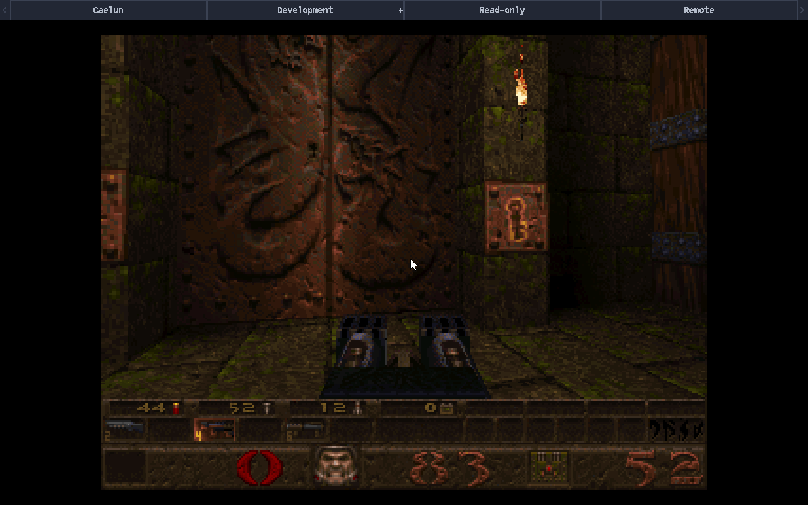
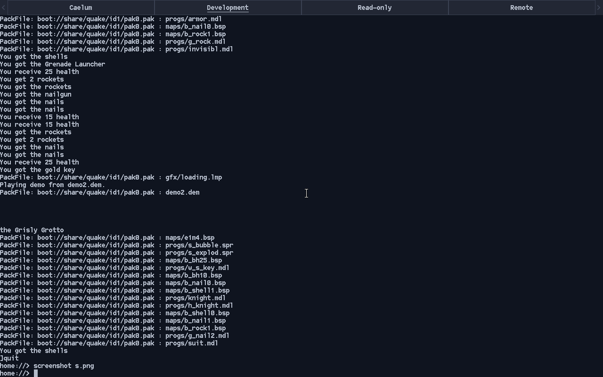
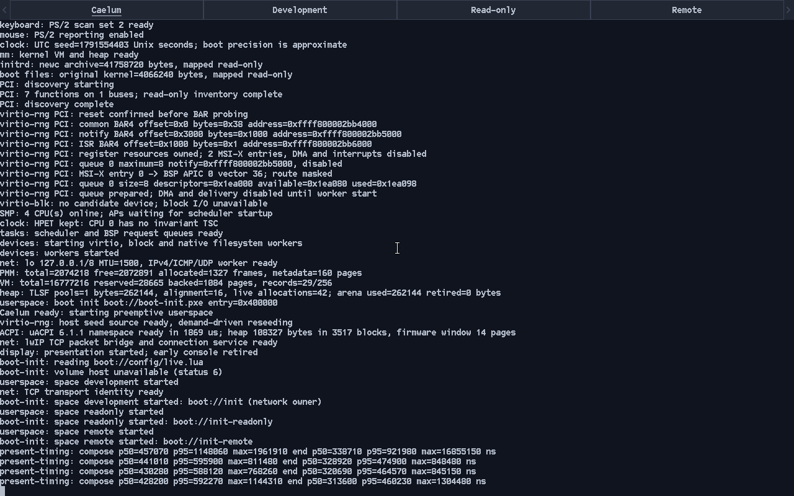
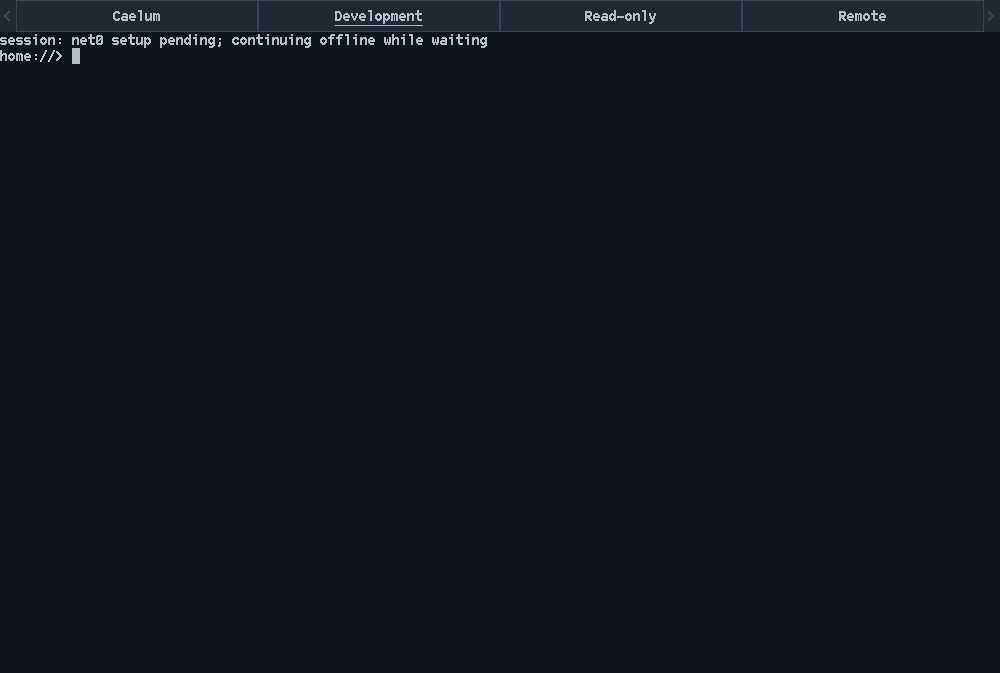

# Gallery

Screenshots of Pyxis running, kept as a project album. Images are in
[images/](images/). This is not a reference: captions record what was shown on the
stated revision and machine, and nothing here establishes behavior.

Rules for entries:

- Each caption gives the date, the revision or PR, the machine and one line on
  what is interesting. A glitch entry also names the bug and its fix.
- Glitches must be natural. A frame captured from a real bug or failure belongs
  here; staged or manufactured glitch art does not (owner rule, 2026-10-10).
- Prefer Pyxis-native captures: a QEMU screendump of Pyxis itself or the
  [`screenshot`](../userland/screenshot.md) tool.
- Check each image for MAC addresses, serial numbers, UUIDs, personal names or
  emails, and browser or desktop content from the owner's machines. Mask or skip
  anything doubtful.
- Compress losslessly and keep each image within a soft budget of a few hundred
  KB. Native resolution is fine.

## Highlights

**Quake in the Development space, 2026-10-09.** Main `31af2224` with the local timing
patch (the base of the
[Renoir presentation qualification](../development/experiments/renoir-presentation/README.md)),
QEMU 10.2.2 Q35, four CPUs, UEFI boot framebuffer at 1280x800. A demo of the
shareware episode running under the native Quake port, with the space bar above it
and the software pointer visible.

**"You need the gold key", 2026-10-09.** Pyxis `20bf9f8f`
([#626](https://git.internal/PyxisOS/pyxis-os/pulls/626)), QEMU 10.2.2 Q35, four
CPUs, VirtIO GPU at 1280x800. Quake on the VirtIO display backend.

**Quake's log and the `screenshot` tool, 2026-10-09.** Pyxis `20bf9f8f`
([#626](https://git.internal/PyxisOS/pyxis-os/pulls/626)), QEMU 10.2.2 Q35, four
CPUs, UEFI boot framebuffer. After `]quit` the shell prompt returns, and
`screenshot s.png` runs; the pack-file loading lines show what Quake read from
`boot://`.

**The Caelum tab, 2026-10-09.** Main `31af2224` with the local timing patch, QEMU
10.2.2 Q35, four CPUs, Bochs display. The kernel log pinned in the first tab shows
the boot sequence from PCI discovery and SMP through ACPI, networking and the
three spaces starting, ending in presentation timing lines.

**Following a window resize, 2026-10-09.** Pyxis `20bf9f8f`
([#626](https://git.internal/PyxisOS/pyxis-os/pulls/626)), QEMU 10.2.2 Q35, GTK
display with VirtIO GPU, window resized to 1000x673. The guest picks up the new
size and the space bar redistributes its tabs across it.

## Glitches and failures

No entries yet. A natural capture of a real glitch or failure goes here with the
bug and its fix, for example:

> **Short title, date.** Revision or PR, machine. What the frame shows, the bug
> behind it and the change that fixed it.
