# Gallery

Screenshots and photos of Pyxis running, kept as a project album. Images are in
[images/](images/). This is not a reference: captions record what was shown on the
stated revision and machine, and nothing here establishes behavior.

Rules for entries:

- Each caption gives the date, the revision or PR where it is known, the machine
  and one line on what is interesting. A glitch entry also names the bug and its
  fix, or says plainly that the cause is not identified.
- Glitches must be natural. A frame captured from a real bug or failure belongs
  here; staged or manufactured glitch art does not (owner rule, 2026-10-10).
- Prefer Pyxis-native captures: a QEMU screendump of Pyxis itself or the
  [`screenshot`](../userland/screenshot.md) tool. Phone photos are for hardware.
- Check each image for MAC addresses, serial numbers, UUIDs, personal names or
  emails, other screens and reflections, and desktop or browser content from the
  owner's machines. Strip all photo metadata. Mask or skip anything doubtful.
- Keep each image within a soft budget of a few hundred KB. PNGs are optimized
  without loss; photos and the one busy game frame below are downscaled or
  re-encoded as JPEG.
- The Doom, Quake and Diablo frames show the shareware games running on Pyxis; the
  game data is supplied locally and is not in the repository.

## Highlights

**blurgtext, 2026-10-24.** Four-CPU QEMU/KVM, Pyxis `688bdd473e1f`, ports
`3568a53`. The unchanged upstream demo runs with real bundled FreeType/HarfBuzz
over SDL2/OSMesa, using its exact Roboto and SVG EmojiOne assets plus Noto CJK
from the single fonts package. The 800×632 framebuffer contains an unscaled
800×600 demo canvas under the native tab bar; bold, italic, emoji and Chinese
fallback are visible. [Qualification and reference comparison](../development/experiments/blurgtext/README.md).

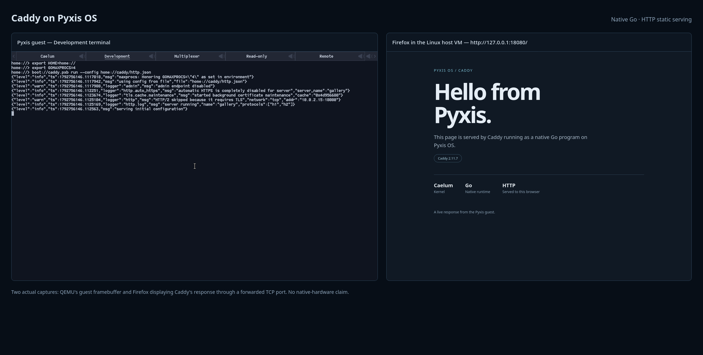

**Caddy serves its first page, 2026-10-23.** Four-vCPU nested QEMU/KVM,
1280×800 standard VGA. The guest Development terminal runs Caddy 2.11.7 with
Go `d37622551c` and the Caddy delivery stack (userland #365, ports #155/#156;
parent based on `dc8319ea`). Firefox in the Linux host VM fetched the page
through the guest's forwarded TCP listener. This is a labeled layout of two
actual captures: QEMU's framebuffer and Firefox's response view. It is not a
physical-machine qualification. Static content matched its source hash.

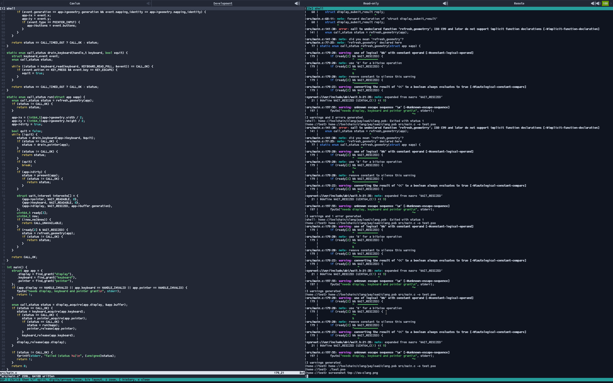

**The first wall of Clang errors on Pyxis, 2026-10-17.** vela from the installed
stick (personal build of `6f287f9e`), hosted Clang 23.1.3 under
`home://toolchain/clang`, captured with `screenshot`. The multiplexer splits
Neovim, editing a hand-typed copy of the
[pointer-min example](../../userspace/examples/pointer-min/main.c), from the
shell's colored diagnostics, including Clang catching `ready[2] && WAIT_RESIZED`
where a bitwise `&` was meant. Converted to a lossless 17-colour PNG.

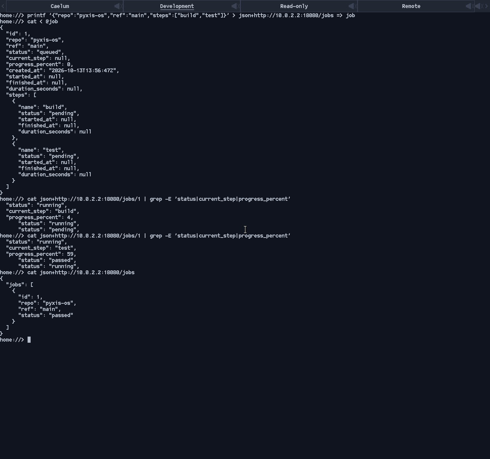

**A CI job demo through native HTTP, 2026-10-13.** Pyxis `e46c51b7`
([#785](https://git.internal/PyxisOS/pyxis-os/pulls/785)), QEMU 10.2.2 Q35, four
CPUs, standard VGA at 1280×1200. The interactive shell submits JSON with
`=> job`, reads the retained reply with `cat < @job`, polls build/test progress
and lists the passed job. The host-side in-memory demo fixture runs no builds.

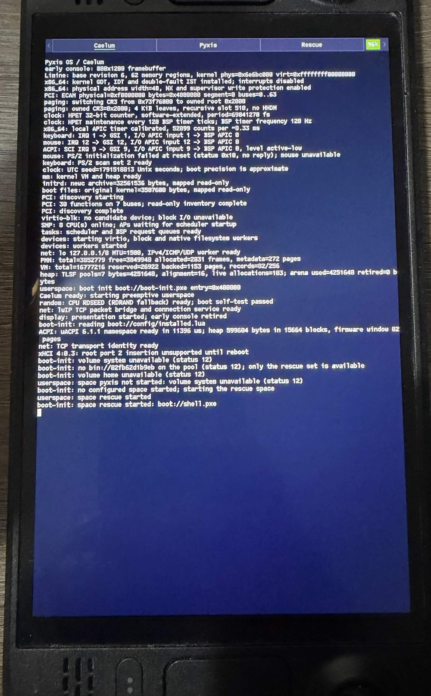

**The first Steam Deck boot into Pyxis, 2026-10-09.** Steam Deck OLED, photo of the
panel (cropped). Limine and Caelum from a USB-C stick: 8 CPUs, HPET and uACPI up,
the battery in the bar, and the 800x1280 portrait panel unrotated. The log ends in
the rescue space because the system and home volumes were unavailable. The record
is in [Steam Deck: first boot](../wip/steam-deck.md#first-boot-2026-10-09); the
revision is not stored with the photo.

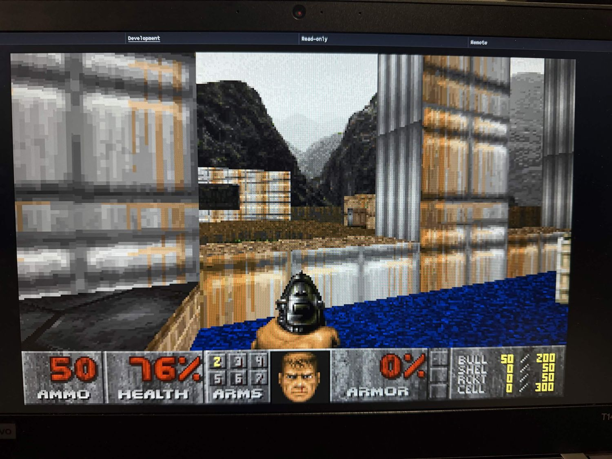

**Doom, 2026-10-03.** ThinkPad T14, photo of its screen (the badge is at the bottom
right). Doom under the Development space's tab bar; the revision is not recorded.

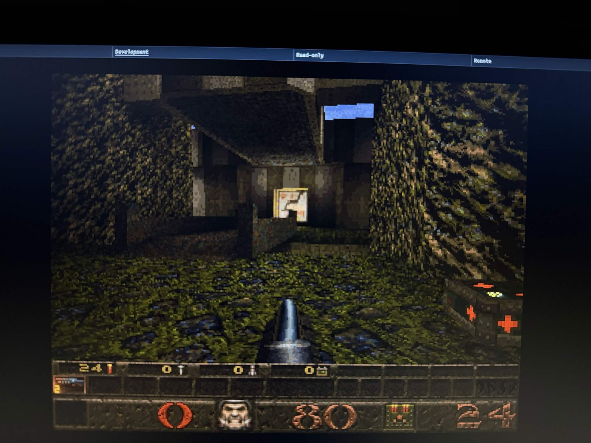

**Quake, 2026-10-04.** Photo of a laptop display, presumably the ThinkPad (the photo
does not say). Quake's software renderer in the Development space; the revision is
not recorded.

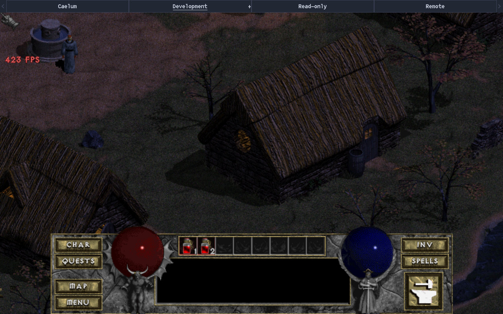

**DevilutionX in Tristram at 423 FPS, 2026-10-08.** QEMU at 1280x800, from the SDL2
bring-up (probably the probe's setup of nested KVM, four CPUs and standard VGA; not
recorded for this series). Shareware Diablo with the FPS counter on and vsync left
at its default. The revision is not recorded. Re-encoded as JPEG to fit the size
budget.

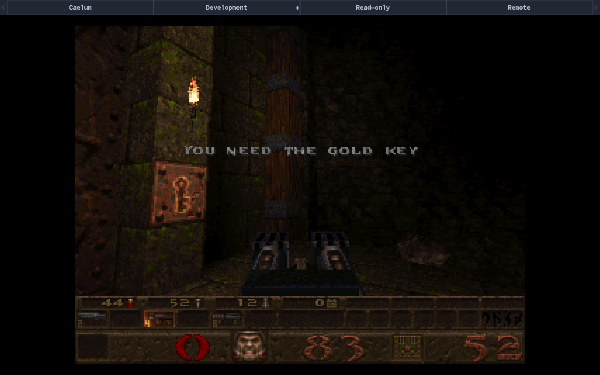

**"You need the gold key", 2026-10-09.** Pyxis `20bf9f8f`
([#626](https://git.internal/PyxisOS/pyxis-os/pulls/626)), QEMU 10.2.2 Q35, four
CPUs, VirtIO GPU at 1280x800. Quake on the VirtIO display backend.

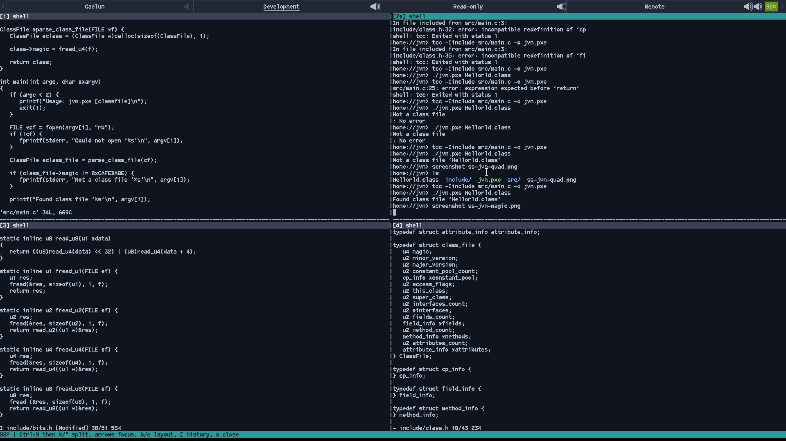

**The first JVM recognizes a class file, 2026-10-10.** ThinkPad T14 (native, 1080p
panel with the battery in the bar); revision not recorded. The owner's hand-written
JVM, built on Pyxis with Neovim and TCC in a four-pane mux: `jvm.pxe Hellorld.class`
prints `Found class file`, after the program checked the `0xCAFEBABE` magic.

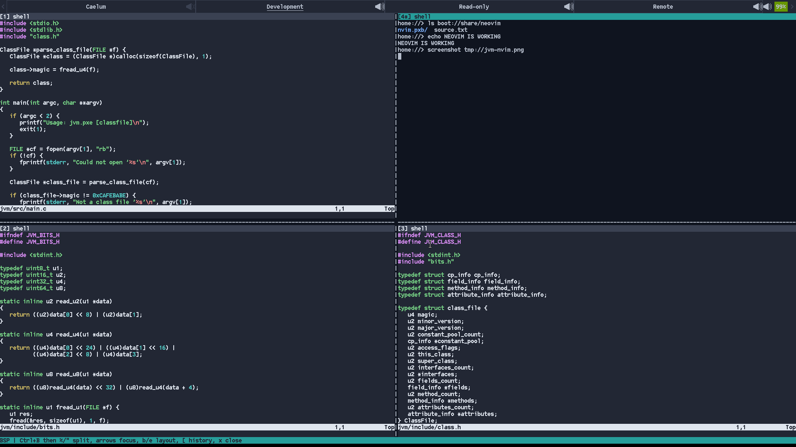

**Neovim in mux panes, 2026-10-10.** ThinkPad T14 (native); revision not recorded.
The JVM sources open in three Neovim panes with syntax highlighting, beside a shell
that had just printed `NEOVIM IS WORKING`.

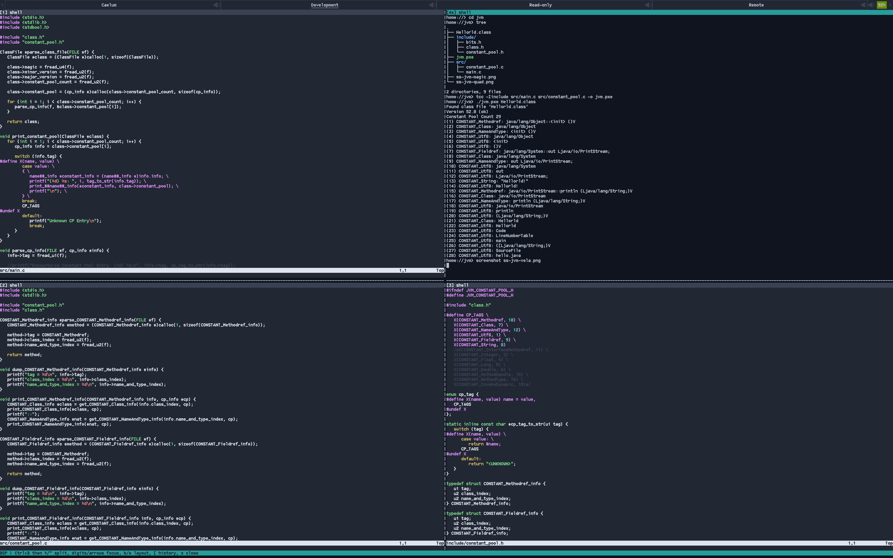

**The first screenshot taken on vela, 2026-10-15.** Pyxis 0.0.5 (`2aa4e13e`,
[#863](https://git.internal/PyxisOS/pyxis-os/pulls/863)) installed on a 128 GB USB
stick, on vela: the IdeaPad Slim 5 16IPH11 (Intel Panther Lake, 2880x1800 OLED).
Taken with `screenshot` into `home://` and copied off through the npfs FUSE mount.
Four mux panes: Neovim on `src/main.c`, `src/constant_pool.c` and
`include/constant_pool.h`, and a shell that built `jvm.pxe` with TCC on vela and
parsed `Hellorld.class`'s 29 constant-pool entries. Compare the
[ThinkPad shot](images/2026-10-10-jvm-neovim-mux-thinkpad.png) (1920x1080): the
cells are the same native 8x16 with no scaling, so the panel holds about 360x112
cells against about 240x67, and each pane of a 2x2 split shows about 54 lines
against about 29.

## Glitches and failures

Each entry is a frame captured while something was actually broken.

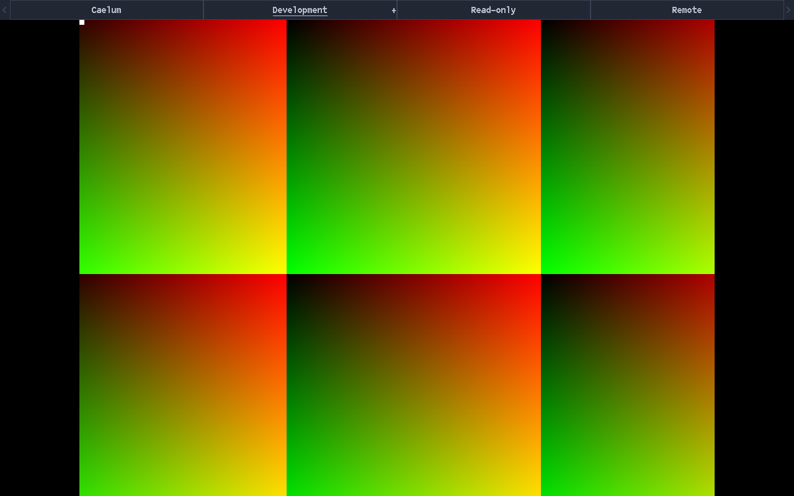

**A seam in a test pattern, 2026-10-08.** SDL2 probe
([#522](https://git.internal/PyxisOS/pyxis-os/pulls/522)), QEMU 10.2.2, nested KVM,
four CPUs, standard VGA at 1280x800. The probe's 640x480 texture, scaled and
centred; the horizontal seam is single-buffer tearing caught mid-copy, per the probe
notes. Presentation was later reworked (RAM staging with a completed-frame
handoff, [#610](https://git.internal/PyxisOS/pyxis-os/pulls/610) and
[#618](https://git.internal/PyxisOS/pyxis-os/pulls/618)); this particular frame was
not re-checked afterwards.

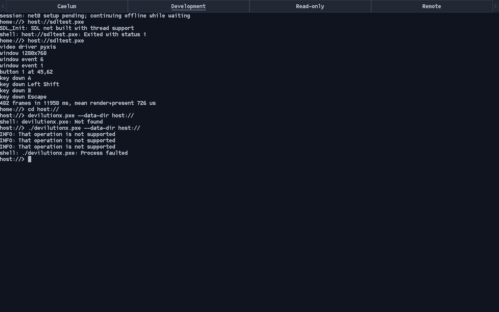

**DevilutionX faults, 2026-10-08.** SDL2 probe
([#522](https://git.internal/PyxisOS/pyxis-os/pulls/522)), same QEMU setup.
`./devilutionx.pxe` prints three "operation not supported" lines and then
`Process faulted`. The bug: SDL's dummy filesystem had no Pyxis `DirectoryExists`,
so Clang compiled `RecursivelyCreateDir` down to an `int3`, and user mode takes a
general-protection fault. The fix was a `stat` branch in that function. The lines
above are the SDL test program's first run, where `SDL_Init` refused a timer
because SDL was built without thread support.

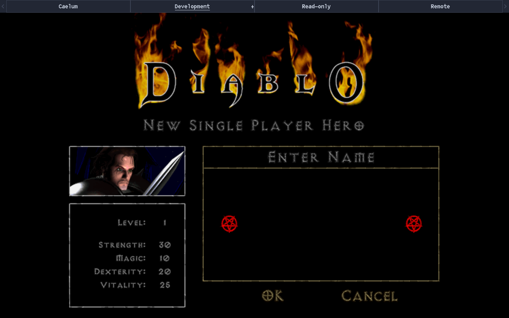

**Typing does nothing, 2026-10-08.** SDL2 probe
([#522](https://git.internal/PyxisOS/pyxis-os/pulls/522)), same QEMU setup. The
shareware "Enter Name" screen stays empty. The bug: the probe's video driver sent
key presses but no `SDL_TEXTINPUT`. The fix was a US key-to-text table, after which
the field shows the hero's name.

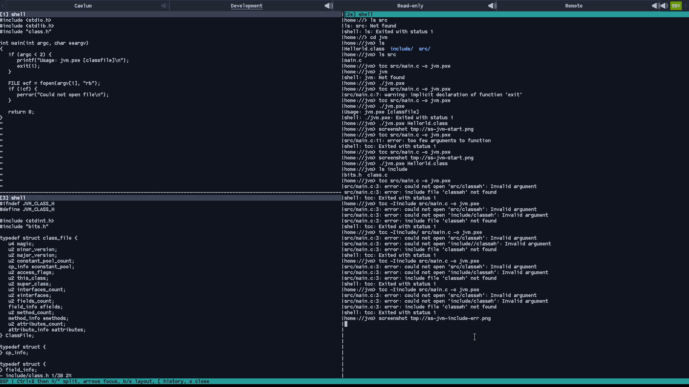

**TCC cannot open a header it should find, 2026-10-10.** ThinkPad T14 (native);
revision not recorded. Compiling the JVM with `-Iinclude` fails with "could not open
'src/classøh'" and "include/classøh: Invalid argument", then "include file 'classøh'
not found", for a source that includes `"class.h"`: the dot arrives as `ø`. The
cause and fix are not identified in the documents or history; the same project
compiled later that morning.

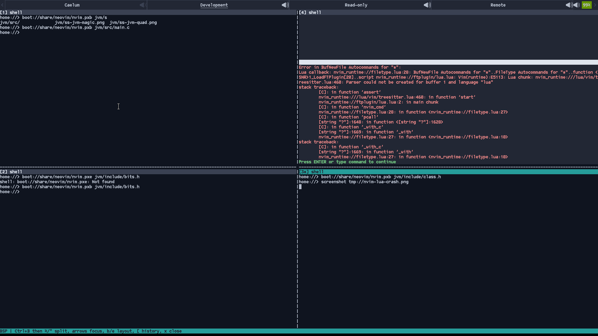

**Neovim fails opening a new Lua file, 2026-10-10.** ThinkPad T14 (native), before the
fixes below. A new buffer's `BufNewFile` autocommand runs the Lua ftplugin, whose
Tree-sitter start raises `Parser could not be created for buffer 1 and language
"lua"`. The ports change
that registers the bundled grammars statically (`14347d5`, that evening) is what
the Neovim reference now describes: an unavailable language returns no parser and
highlighting quietly keeps legacy syntax.

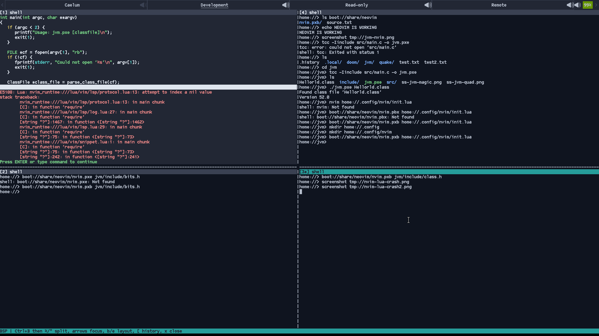

**`vim.lsp` fails to load, 2026-10-10.** ThinkPad T14 (native), same session. The
editor reports `lsp/protocol.lua:13: attempt to index a nil value` while loading
`vim.snippet` and `vim.lsp`. The bug: they index `os_uname()`, which Pyxis's libuv
did not answer. The fix: libuv now answers `os_uname`, the home and temporary
directories and the hostname (ports `ad28405`, with the editor server receiving
`SYSTEM_INFO` in `a0daf23`); see [Neovim](../userland/neovim.md).
